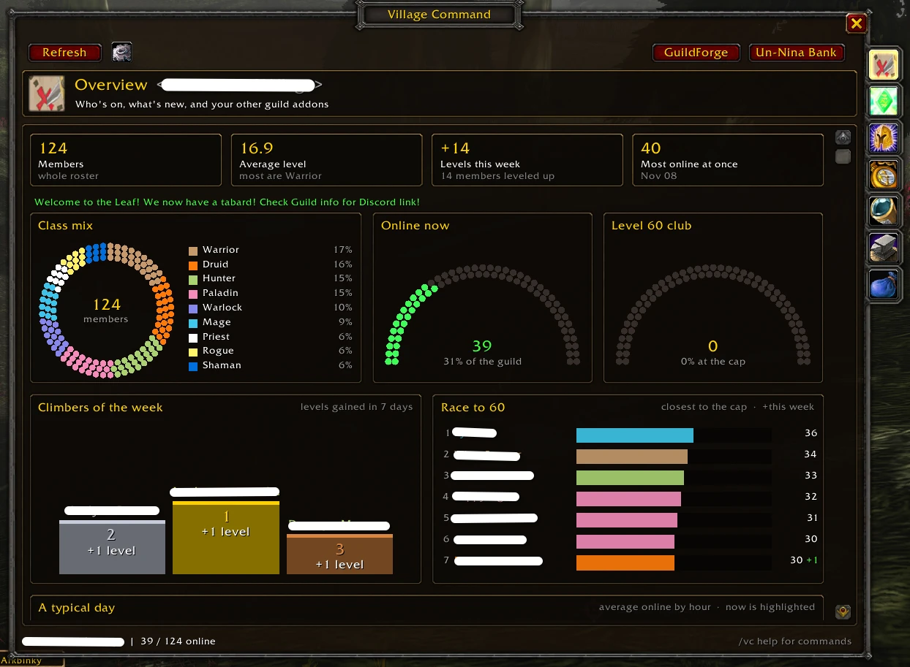
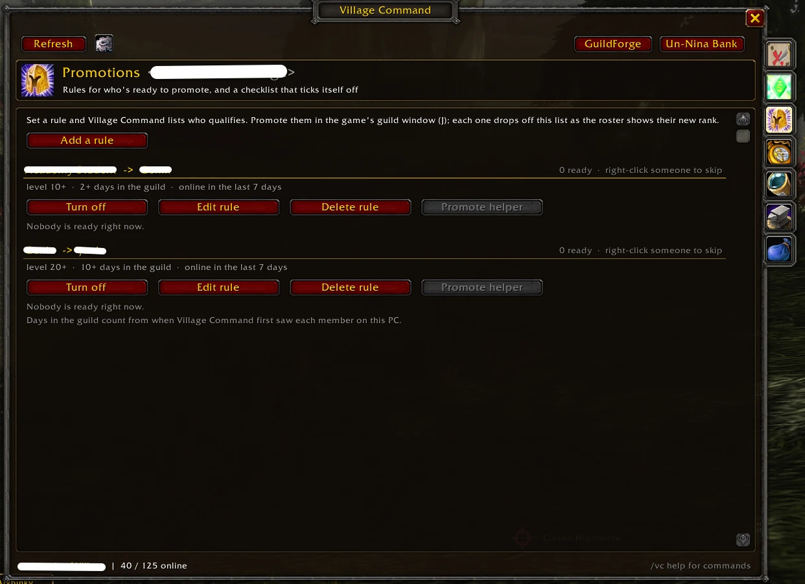
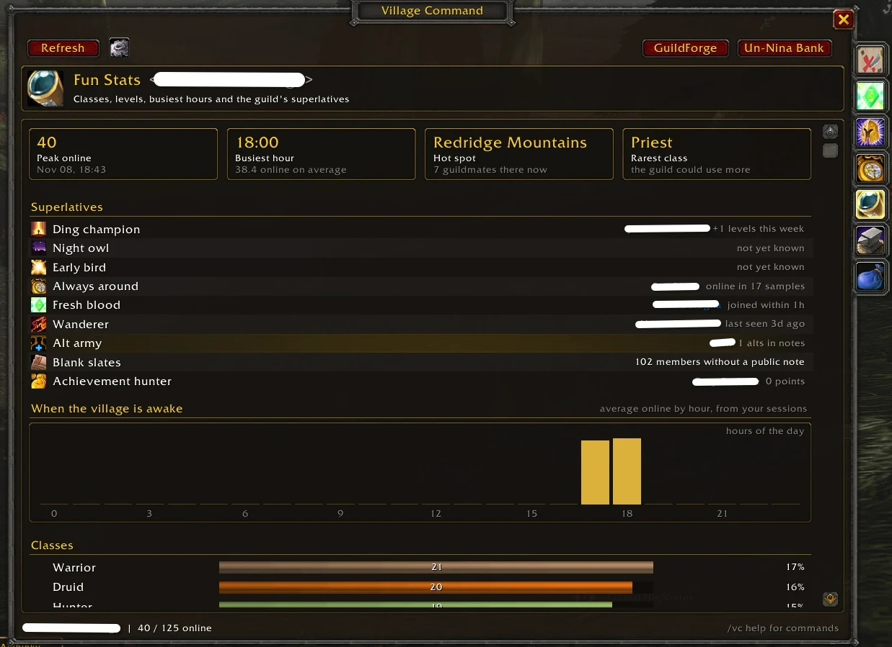

<!-- Paste everything below this line into the CurseForge project description (Markdown mode). -->

# Village Command

**Run your guild from one window.**

Village Command is a guild overview and progression suite. See everyone who's online, keep the roster tidy with notes and officer notes, promote or demote one member or fifty at once (Classic Era), and watch the guild grow with progression tracking and fun stats. If you use **GuildForge** or **Un-Nina Bank**, they're in the same window too.

Built for **WoW Forever**. Also works on **Classic Era** and **Retail**.

## A dashboard that shows how everyone's doing

- **Class mix** as a beaded ring, and dot gauges for **who's online** and the **level-cap club**.
- **Climbers of the week** on a podium, and the **Race to the cap** leaderboard.
- **A typical day** line graph, a **weekly rhythm** heat map, the **Hall of fame**, levels gained per day and the level spread.
- Who's online as a compact grid. Click anyone to open them in the roster.

## Level-up celebrations

- A raid-warning style **congratulations** on your screen when a guildmate reaches level 20, 40 or 50 (your choice of levels).
- A **big banner with fireworks** and the level-up fanfare when someone hits the level cap.
- Turn any of it off, or change the levels, under Settings > Celebrations.
- **Minimap button** (a guild tabard) with a green badge counting guildmates online; hover it for who.

## The whole roster, in one fast list

- Class-colored names, level, rank, zone (or how long since they were last on), public note and officer note.
- **Search** names, notes, officer notes, zones, classes and ranks. **Filter** to online only, one rank, a level range, or members away 14, 30 or 90+ days. Click a column to sort.
- **Click a member** to see their notes and rank; on Classic Era, edit them right there or promote and demote. **Right-click** to whisper or invite.
- Big guilds scroll smoothly: only the rows on screen are drawn.

## Mass promote, demote and notes (Classic Era)

Tick members, shift-click a range, or tick everyone your filters show, then:

- **Promote**, **Demote** or **Set rank** for all of them at once.
- Set **public notes** or **officer notes**: replace, add to the end, add to the start, or clear. `{date}`, `{level}`, `{rank}`, `{class}` and `{name}` fill in for each member, with a preview before you apply.

It asks first and names who's affected, sends changes one at a time so the server takes every one, waits out combat, and can be cancelled part way. It follows the game's rules: you can only move members ranked below you, and anyone your rank can't change is skipped with the reason.

**WoW Forever: notes are view-only, promotions go through the Promote helper.** Forever only lets the game's own guild window change notes, and blocks addons from promoting directly. Village Command shows, searches and tracks notes there, and its **Promote helper** promotes through the game's `/gpromote` command, several people per click. Mass promote, demote and notes work on **Classic Era**. If the game blocks an action anywhere else, Village Command stops, says so once, and greys that action out with the reason.

## Shared history

- Guildmates running Village Command compare notes at login, so days in the guild, level history and the activity feed cover **everyone's** playtime.
- Light on chat: a short hello, and only when histories differ, a few dozen small messages at the game's pace.
- Joins, leaves and rank changes are only taken from ranks you trust. Turn it off any time.

## Promotion checklist

- Set rules like **Genin -> Chunin: level 20+, 14+ days in the guild, online in the last 7 days**, and the **Promotions** tab lists everyone who qualifies, online members first.
- On WoW Forever, the **Promote helper** promotes the next few people on the list with each click, and learns how many the server takes at once. On Classic Era, **Promote all** does the whole list. Each member drops off the list as the roster shows their new rank, and the week's promotions are listed under the rule.
- Right-click someone to skip them, or switch a rule off without losing it. Ready members say so in their tooltip, and the minimap tooltip counts them.

## Progression

- **Milestones:** roster size, members at the level cap, average level, and professions covered.
- **This week:** levels gained, new members and leavers, promotions, and the most online at once.
- **Top climbers** over 7 or 30 days, and an **activity feed** of joins, leaves, level milestones and rank changes.

## Fun stats

- **Peak online**, **busiest hour**, today's **hot spot** and the **rarest class**.
- Superlatives: **Ding champion**, **Night owl**, **Early bird**, **Always around**, **Fresh blood**, **Wanderer**, **Alt army** (from "Alt of ..." notes), **Blank slates** and **Achievement hunter** (Retail).
- Charts of who's online by hour, and the guild by class, level and rank.

History is recorded by your own client as it sees the roster, so these fill in over the days you play. It stays on your PC; turn it off or reset it in Settings.

## Better with GuildForge and Un-Nina Bank

Both are optional. When they're installed:

- **[GuildForge](https://github.com/TheFrosty02/GuildForge):** a **Professions** page with each profession's members, top skill and online crafters, crafters online right now, and professions in every member's tooltip.
- **[Un-Nina Bank](https://github.com/kota150/GuildBankToons):** a **Guild Bank** page with bank gold and its 14-day history, bank toons and tabs, open requests, and buttons straight to the bank's Requests, Ledger and Goals. Bank toons are tagged in the roster.

## Getting started

1. Install Village Command and log in.
2. Open it from the guild tabard on the minimap, the AddOns menu, or `/vc`.
3. Tick **Show offline** on the Roster page so Village Command can see the whole guild (and notice who leaves).

Anyone can browse; promoting, demoting and editing notes follow your guild rank's permissions.

| Command | What it does |
| --- | --- |
| `/vc` | Open or close the window |
| `/vc roster`, `/vc promotions`, `/vc progress`, `/vc stats`, `/vc forge`, `/vc bank` | Open a page |
| `/vc online` | List who's online in chat |
| `/vc cancel` | Stop a mass change part way |
| `/vc status` | Show what your rank is allowed to change |

Found a bug or have an idea? Leave a comment here on CurseForge.
