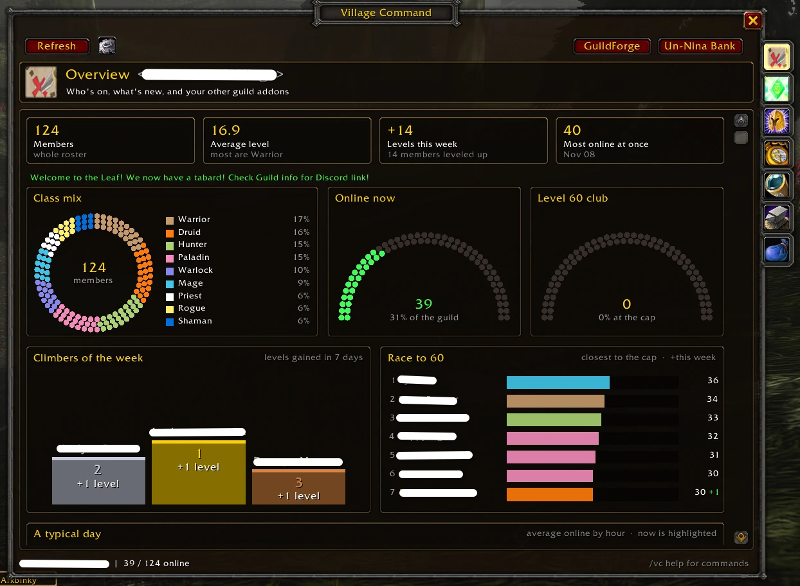
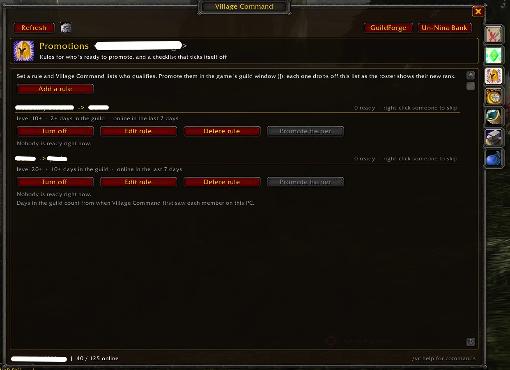
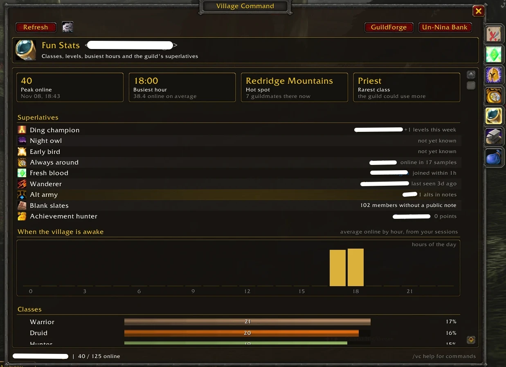

# Village Command

**Run your guild from one window.** Village Command is a guild overview and progression suite: see everyone who's online, plan events with signups and attendance, post bounties, manage the roster with notes and officer notes, promote and demote one member or fifty at once (Classic Era only), and watch the guild grow with progression tracking and fun stats. It also brings your other guild addons, **[GuildForge](https://www.curseforge.com/wow/addons/guild-forge-guild-profession-tracker)** and **[Un-Ninja Bank](https://www.curseforge.com/wow/addons/un-ninja-bank-guild-bank-sharing)**, into the same window.

Built for **WoW Forever**, and also works on **Classic Era** and **Retail**.

> **On WoW Forever, Village Command can't promote, demote or change notes.** Blizzard only lets the game's own guild window (J) change ranks, public notes and officer notes on Forever, and blocks every addon from doing it. On Forever you can see, search and track ranks and notes in Village Command, but **change them in the guild window**. The one exception is the **Promote helper** on the Promotions tab: it can promote people on your checklist, a few per click, by having the game run its own `/gpromote` command. There is no way around it for demoting or notes. Mass promote, demote and note changes work on **Classic Era**.



## Features

### Overview: a dashboard
A different kind of graph for each question, built to show how well everyone's doing:

- **Class mix** as a beaded ring, and dot gauges for **who's online** and the **level-cap club**.
- **Climbers of the week** on a podium, and the **Race to the cap**: who's closest, and how much they gained this week.
- **A typical day** (line graph of who's online by hour) and the **weekly rhythm** (heat map by day and hour).
- **Hall of fame** of everyone who hit the cap, **levels gained per day** and the **level spread**.
- Who's online right now as a compact grid, the message of the day, recent activity, and your other guild addons.

Hover for details; click any name to open them in the roster.

### Level-up celebrations
When a guildmate passes one of your chosen levels (20, 40 and 50 to start), a raid-warning style message congratulates them on your screen. At the level cap, it's a banner with fireworks and the level-up fanfare. Choose the levels, or turn the message, the banner or the sound off, under **Settings > Celebrations** (with previews). Only level-ups seen while you're online count; nothing is sent to anyone.

### Roster
The whole guild in one fast list: class-colored names, level, rank, zone (or how long since they were online), public note and officer note.

- **Search** names, notes, officer notes, zones, classes and ranks.
- **Filter** to online only, one rank, a level range, or members away 14, 30 or 90+ days. Click a column to sort.
- **Click a member** to see their notes and rank below the list. On **Classic Era** you can edit the notes there and promote or demote; on **WoW Forever** they're read-only (use the guild window). **Right-click** to whisper or invite (and on Classic Era, promote, demote or tick them).

### Mass promote, demote and notes (Classic Era only)
Tick members, shift-click a range, or tick everyone the filters show, then:

- **Promote**, **Demote** or **Set rank** for all of them.
- Set **public notes** or **officer notes**: replace, add to the end, add to the start, or clear. `{date}`, `{level}`, `{rank}`, `{class}` and `{name}` fill in per member, and a preview shows the result.

Village Command asks first and names who's affected. Changes go out one at a time a moment apart (adjustable in Settings) so the server accepts every one, pause during combat, and can be cancelled part way. It follows the game's rules: you can only move members ranked below you, never to your own rank or above, and anyone it can't change is skipped with the reason.

**Not on WoW Forever.** None of the above works on Forever: Blizzard blocks addons from promoting, demoting and changing public or officer notes there (tested in game, even for one member from a click), so the roster drops the tick boxes and mass actions and points you to the guild window (J). The only rank change Village Command can make on Forever is through the **Promote helper** (below), which has the game run `/gpromote` from your clicks. Anywhere else, if the game blocks one of Village Command's actions, it stops, explains once in chat, and greys that action out with the reason, remembered per version of the game. `/vc unblock` lets it try again after a game patch.

### Events: signups and attendance
Plan a raid, dungeon run, PvP night or get-together, and guildmates running Village Command sign up from the **Events** tab.

- **New event:** a name, type, day and time, how many players you need, and a note. Everyone sees it in their own time zone.
- **Sign up** as **Tank**, **Healer** or **Damage**, or say **Maybe** or **Can't come**. The event shows who's coming in each role, the classes coming (so a leader sees what's missing), and who said maybe or can't.
- **Reminders:** a line in chat 15 minutes before an event you signed up for or lead, and when it starts.
- **Attendance:** the leader (or an officer) clicks **Take attendance** while in a group or raid, and everyone from the guild in it is recorded. If the leader is in a group 15 minutes after the start, Village Command takes it on its own, even inside the raid. **Regulars** lists who came to the most events in the last 60 days, and member tooltips say "At 4 of the guild's last 6 events".
- **Announce in guild** posts one line about the event in guild chat, for guildmates without the addon.
- The next few events show on the **Overview** under *Coming up* (with your answer), and the next one in the minimap tooltip.

### Bounty board
Post what you need on the **Bounties** tab and guildmates take it on.

- **Post a bounty:** type what you're after ("help with Jintha'Alor elites") or shift-click an item, say how many, the reward in gold and silver, and how long it stays up (3 to 30 days).
- **I'm on it** tells the guild you're hunting it. For item bounties your bag count is shared as you collect ("12/20"), so the poster can see how close you are. **Mark sent** once you've mailed or traded it.
- The poster clicks **Done...** and picks who earned it. It goes in the activity feed, and **Bounty hunters** ranks who completed the most in the last 90 days, with the gold they earned.
- **Addons can't hold gold.** The reward is a promise on the board: the poster pays it in the game, by mail or trade.

### Sharing events and bounties
Events and bounties go out to guildmates running Village Command the moment they're posted or changed. Anyone who was offline catches up at login the same way shared history does: a short hello, and only if something differs, a copy from one guildmate (about 25 messages for a busy board). Events from the last two weeks and bounties that are open or closed in the last two weeks are shared; older ones are kept on your PC for 90 days for attendance and the leaderboards.

**Who can change what:** only the leader or poster, or the trusted ranks (Settings > *Trust shared history from*), can edit, cancel or close an event or bounty. Signups and hunts only ever change their own person. Each person can have 6 upcoming events and 6 open bounties (the trusted ranks 25). Addon messages can't be signed, so a guildmate with a modified addon could still relay a fake change. Village Command limits that: when it sees a different copy of one of *your* events, bounties, signups or hunts, it sends yours again, so the real one wins whenever you're online.

### Village Points: raid points and loot priority
The **Village Points** tab keeps a points system for raids and loot that the whole guild can see.

- **Earn Village Points by raiding:** 10 for being on time and 15 for each boss kill you're there for, by default. Officers can add points for each hour in the raid too.
- **Loot costs Loot Points.** An officer awards it (**Award loot...**, or `/vc points award Mira` and shift-click the item). The cost is suggested from the item's level and slot. Everyone starts with 50 Loot Points, so a newcomer with one raid isn't first in line.
- **Priority = Village Points ÷ Loot Points.** The highest goes first. Both fade 10% a week, so recent raiding counts most. Points older than 26 weeks drop off.
- **Standings** list everyone with their points, priority and raids in the last 30 days. Hover a name to see each change: when, how many, why and who made it. Member tooltips show it too.
- **Officers** can award loot, adjust points by hand with a reason, give **bench** players a share of what a raid earned (half by default), undo their last change, and set the **Rules**. Every value above is a rule, and everyone's standings follow a change at once.

**How a raid is counted.** Addons can't talk inside instances, so nothing is sent during the raid. Each player's Village Command keeps a report of what it saw:
- when they went in;
- which guildmates were in the raid, online and in the same zone, and for how long;
- every boss kill, and who was there for it.

A raid counts once 5 guildmates are in it together (a rule), and only inside a raid instance: dungeon runs never count, even in a raid group. Once a player is out, their report goes to the officers. An officer's Village Command waits 5 minutes for the others, then settles the raid:
- **Yes/no questions** go by majority vote, with an officer breaking ties. For example: was Gehennas killed? Was Bolt there for it?
- **Numbers** use the median, which ignores outliers. For example: when did someone arrive, and how long did they stay?
- **Quorum:** a raid needs reports from 3 clients or from one officer. With fewer, it waits on the tab for an officer to **approve** it.
- **Late reports:** reports that arrive within half an hour are counted in and the raid is settled again.
- **Officers still inside:** if an officer is still in the instance when the others leave, every unsettled report is sent again when that officer comes out.
- **Flags:** reports that disagree with the result are flagged for officers. For example, a client claiming kills nobody else saw.

Guildmates in the raid without the addon still earn points, because the others' reports include them. A player who disconnects misses the bosses killed while they were offline.

**Trust.** Only officers can award loot, change points or change the rules. Officers are the ranks from Settings > *Trust shared history from*. Each report counts as one vote from the player who sent it, because the game says who sent each message. A modified addon can't add points: its kills and times are outvoted, and it can't settle a raid. Guildmates who were offline catch up at login. Only the weeks that differ are sent, and a copy counts if it comes from an officer, or from two guildmates who agree.

**Why not officer notes?** On WoW Forever, only the game's own guild window can change officer notes. A `/vc` command can't either, so Village Points keeps its own shared ledger instead.

### Renown
Renown is a community score that is never used for loot:
- 3 for each event you attended (last 60 days);
- 5 for each bounty you earned (last 90 days);
- 1 for each level you gained (last 30 days).

The top 10 are on the Village Points tab, and the Discord companion shows the top 5.

### Shared history
Guildmates running Village Command compare what they've seen when they log in, so **days in the guild**, level history and the activity feed cover everyone's playtime, not just yours. It's light: a short hello at login, and only when histories differ, a few dozen small messages at the game's pace (about 50 bytes per member). Joins, leaves, rank changes and earlier first-seen dates are only taken from trusted ranks (**Settings > Trust shared history from**), or, for first-seen dates, from two guildmates who agree. Online-by-hour graphs stay your own. Turn sharing off in Settings.

### Promotion checklist
Set rules like **Genin -> Chunin: level 20+, 14+ days in the guild, online in the last 7 days**, and the **Promotions** tab lists everyone who qualifies, online members first. Promote them with **Promote all** (Classic Era), or on WoW Forever with the **Promote helper** or in the game's guild window; each one drops off the list as the roster shows their new rank, and the week's promotions are listed under the rule. Right-click someone to skip them, and switch a whole rule off (and back on) without losing it. Members who are ready say so in their tooltip, and the minimap tooltip counts them.

**Promote helper (WoW Forever):** a rule's **Promote helper** button opens a small window lined up with the next few people on the list. Each click of Promote has the game run a `/gpromote Name` line for each of them (up to 5 by default, adjustable from 1 to 10, as many as fit in a 255-character macro), and that works on Forever even though addons can't promote directly. Village Command then checks the roster: anyone who didn't go through stays at the front for the next click, and anyone missed twice is set aside so the list keeps moving. The server only takes a few promotions in a row, so when a click only partly goes through, the helper lowers the number per click to what worked and remembers it. It hides during combat. There's no chat command for notes, so notes still need the guild window.

Days in the guild count from when Village Command first saw each member, on your PC or (with shared history) a guildmate's.



### Progression
Milestones (roster size, members at the level cap, average level, professions covered), this week's levels gained, joins, leaves and promotions, **top climbers** over 7 or 30 days, **top recruiters**, and an activity feed of joins, leaves, level milestones and rank changes.

### Top recruiters
Who invited whom comes from the game's **guild event log**, the server's own record of invites and joins. It names both people, so it can't be faked or guessed wrong. A recruit counts for whoever invited them **while they're in the guild**: leaving takes them off the board, and someone who comes back counts for whoever invited them back. Invites that were never accepted don't count.

The log only holds the last 100 or so events, so every Village Command reads it every few minutes and keeps what it finds. Guildmates running it share the list, so it outlives the log and covers the days you're not online. A list from a trusted rank is taken on its word; anyone else's needs a second guildmate's to agree. Recruits from before anyone ran Village Command can't be counted, apart from what's still in the log.

Hover a recruiter to see who they brought in. Member tooltips say who invited them. Also `/vc recruits`, or `/vc recruits Name`.

### Fun Stats
Peak online, busiest hour, today's hot spot, the rarest class, and superlatives: **Ding champion**, **Night owl**, **Early bird**, **Always around**, **Fresh blood**, **Wanderer**, **Alt army** (from "Alt of ..." notes), **Blank slates** and **Achievement hunter** (Retail). Plus online-by-hour, class, level and rank charts.

History is recorded by your client as it sees the roster, so Progression and Fun Stats fill in over the days you play. It stays on your PC (nothing is sent to guildmates); turn it off or reset it in Settings.



### With GuildForge and Un-Ninja Bank
Both are optional. When they're installed:

- **[GuildForge](https://www.curseforge.com/wow/addons/guild-forge-guild-profession-tracker)**: a **Professions** page with each profession's members, top skill and online crafters, a list of crafters online now, and professions in every member's tooltip.
- **[Un-Ninja Bank](https://www.curseforge.com/wow/addons/un-ninja-bank-guild-bank-sharing)**: a **Guild Bank** page with bank gold and its 14-day history, bank toons and tabs, and open requests, with buttons straight to the bank's Requests, Ledger and Goals. Bank toons are tagged in the roster.

The **GuildForge** and **Un-Ninja Bank** buttons at the top of the window open those addons directly.

## Commands

| Command | What it does |
| --- | --- |
| `/vc` | Open or close the window (also `/village`, `/villagecommand`) |
| `/vc roster`, `events`, `bounties`, `points`, `promotions`, `progress`, `stats`, `forge`, `bank` | Open a page |
| `/vc points me` (or a name) | Your Village Points, Loot Points, priority and place |
| `/vc points award Name [item] [cost]` | Officers: charge Loot Points for an item (shift-click it in; the cost is suggested) |
| `/vc points add Name 10 reason` | Officers: add (or with `-10`, take away) Village Points |
| `/vc points bench Name` | Officers: the bench share of the latest raid |
| `/vc points undo` | Officers: take back your last change |
| `/vc points cost [item]` | The suggested Loot Points for an item |
| `/vc points rules`, `/vc points set perBoss 20` | See the rules; officers change one |
| `/vc points approve` | Officers: settle raids that had too few reports |
| `/vc recruits` (or a name) | The top recruiters, or who invited someone and who they brought in |
| `/vc online` | List who's online in chat |
| `/vc sync` | Compare history, events, bounties, Village Points and recruits with guildmates now |
| `/vc settings` | Open settings |
| `/vc cancel` | Stop a mass change part way |
| `/vc status` | Show what your rank is allowed to do, and anything the game blocks |
| `/vc unblock` | Try actions the game blocked before again (after a patch) |
| `/vc minimap` | Show or hide the minimap button |
| `/vc quiet` | Only print messages for things you did |

## Discord companion

`companion/villagecommand_discord.py` puts Village Points on Discord. It works like the Un-Ninja Bank companion: WoW addons can't reach the internet, and SavedVariables are only written when you **log out or `/reload`**. The script reads that file and posts through Discord webhooks:

- **Standings:** one message, kept up to date. It shows everyone's Village Points, Loot Points, priority and raids, worked out exactly as the addon does, plus the top of the Renown board.
- **Raids:** each settled raid is posted once, with its bosses and who earned what. The post is edited if officers settle it again.
- **Loot:** each award gets a post ("🎁 Mira received Gloves of Prophecy for 50 Loot Points"), struck through if it's undone.
- **Flags:** optional, sent to an officers' channel (`officer_webhook`).

Every guildmate running the addon has the whole ledger, so anyone can run the script on any PC.

1. In Discord: channel settings > Integrations > Webhooks > New Webhook, then copy its URL.
2. Copy `companion/villagecommand.example.json` to `companion/villagecommand.json` and paste the URL in. That file is git-ignored. Keep the URL private, because anyone who has it can post to the channel.
   - For separate channels, set `raids_webhook` and `loot_webhook`.
   - `top` sets how many places the standings show.
3. Check what it would post:
   ```bash
   python3 companion/villagecommand_discord.py --dry-run
   ```
4. Then leave it running:
   ```bash
   python3 companion/villagecommand_discord.py --watch
   ```

Python 3.8+ with nothing to install. The first run only takes note of raids and loot already recorded, so it doesn't flood the channel; `--backfill` posts them. `--export exports` writes the standings, every points change and the raids to CSV files.

## Installing

Get it from [CurseForge](https://www.curseforge.com/projects/1792191) or the CurseForge app.

### From source

The addon folder must be named `VillageCommand`. Copy or link this repository into `Interface/AddOns/VillageCommand`.

## Tests

`tests/run_tests.py` runs the addon in a stand-in WoW environment with a simulated guild (WoW's Lua 5.1, through lupa): loading, every page, filters, mass promote / demote / set rank, mass notes, progression tracking, the GuildForge and Un-Ninja Bank pages, WoW Forever names, and a whole raid night of Village Points (six clients, a disconnect, a tampered report, loot, decay, catch-up), recruits read from the guild event log and shared, checked against the Discord companion's numbers.

```bash
python3 -m venv .venv && .venv/bin/pip install lupa && .venv/bin/python tests/run_tests.py
```
