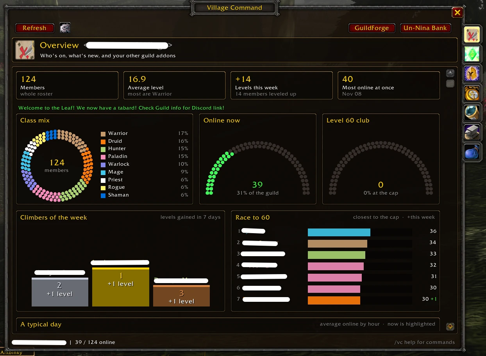
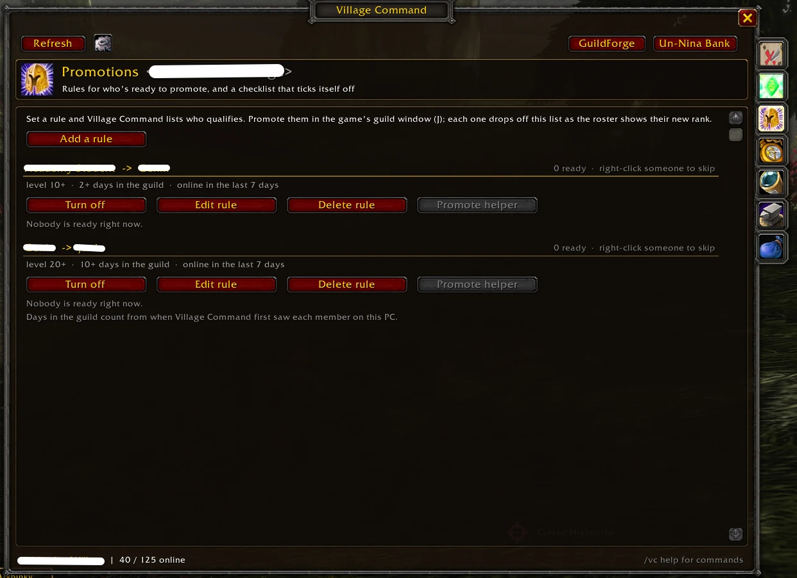
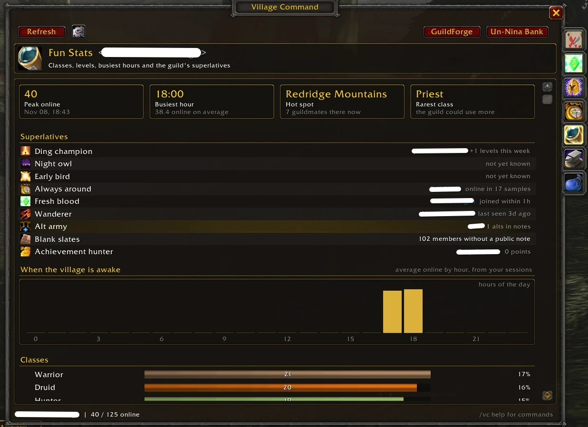

# Village Command

**Run your guild from one window.** Village Command is a guild overview and progression suite: see everyone who's online, manage the roster with notes and officer notes, promote and demote one member or fifty at once (Classic Era only), and watch the guild grow with progression tracking and fun stats. It also brings your other guild addons, **[GuildForge](https://www.curseforge.com/wow/addons/guild-forge-guild-profession-tracker)** and **[Un-Nina Bank](https://www.curseforge.com/wow/addons/un-ninja-bank-guild-bank-sharing)**, into the same window.

Built for **WoW Forever**, and also works on **Classic Era** and **Retail**.

> **On WoW Forever, Village Command can't promote, demote or change notes.** Blizzard only lets the game's own guild window (J) change ranks, public notes and officer notes on Forever, and blocks every addon from doing it. On Forever you can see, search and track ranks and notes in Village Command, but **change them in the guild window**. The one exception is the **Promote helper** on the Promotions tab: it can promote people on your checklist, a few per click, by having the game run its own `/gpromote` command. There is no way around it for demoting or notes. Mass promote, demote and note changes work on **Classic Era**.



## Features

### Overview: a dashboard
A different kind of graph for each question, built to show how well everyone's doing:

- **Class mix** as a beaded ring, and dot gauges for **who's online** and the **level-cap club**.
- **Climbers of the week** on a podium, and the **Race to the cap**: who's closest, and how much they gained this week.
- **A typical day** (line graph of who's online by hour) and the **weekly rhythm** (heat map by day and hour).
- **Hall of fame** of everyone who hit the cap, **levels gained per day** and the **level spread**.
- Who's online right now as a compact grid, the message of the day, recent activity, and your other guild addons.

Hover for details; click any name to open them in the roster.

### Level-up celebrations
When a guildmate passes one of your chosen levels (20, 40 and 50 to start), a raid-warning style message congratulates them on your screen. At the level cap, it's a banner with fireworks and the level-up fanfare. Choose the levels, or turn the message, the banner or the sound off, under **Settings > Celebrations** (with previews). Only level-ups seen while you're online count; nothing is sent to anyone.

### Roster
The whole guild in one fast list: class-colored names, level, rank, zone (or how long since they were online), public note and officer note.

- **Search** names, notes, officer notes, zones, classes and ranks.
- **Filter** to online only, one rank, a level range, or members away 14, 30 or 90+ days. Click a column to sort.
- **Click a member** to see their notes and rank below the list. On **Classic Era** you can edit the notes there and promote or demote; on **WoW Forever** they're read-only (use the guild window). **Right-click** to whisper or invite (and on Classic Era, promote, demote or tick them).

### Mass promote, demote and notes (Classic Era only)
Tick members, shift-click a range, or tick everyone the filters show, then:

- **Promote**, **Demote** or **Set rank** for all of them.
- Set **public notes** or **officer notes**: replace, add to the end, add to the start, or clear. `{date}`, `{level}`, `{rank}`, `{class}` and `{name}` fill in per member, and a preview shows the result.

Village Command asks first and names who's affected. Changes go out one at a time a moment apart (adjustable in Settings) so the server accepts every one, pause during combat, and can be cancelled part way. It follows the game's rules: you can only move members ranked below you, never to your own rank or above, and anyone it can't change is skipped with the reason.

**Not on WoW Forever.** None of the above works on Forever: Blizzard blocks addons from promoting, demoting and changing public or officer notes there (tested in game, even for one member from a click), so the roster drops the tick boxes and mass actions and points you to the guild window (J). The only rank change Village Command can make on Forever is through the **Promote helper** (below), which has the game run `/gpromote` from your clicks. Anywhere else, if the game blocks one of Village Command's actions, it stops, explains once in chat, and greys that action out with the reason, remembered per version of the game. `/vc unblock` lets it try again after a game patch.

### Shared history
Guildmates running Village Command compare what they've seen when they log in, so **days in the guild**, level history and the activity feed cover everyone's playtime, not just yours. It's light: a short hello at login, and only when histories differ, a few dozen small messages at the game's pace (about 50 bytes per member). Joins, leaves, rank changes and earlier first-seen dates are only taken from trusted ranks (**Settings > Trust shared history from**), or, for first-seen dates, from two guildmates who agree. Online-by-hour graphs stay your own. Turn sharing off in Settings.

### Promotion checklist
Set rules like **Genin -> Chunin: level 20+, 14+ days in the guild, online in the last 7 days**, and the **Promotions** tab lists everyone who qualifies, online members first. Promote them with **Promote all** (Classic Era), or on WoW Forever with the **Promote helper** or in the game's guild window; each one drops off the list as the roster shows their new rank, and the week's promotions are listed under the rule. Right-click someone to skip them, and switch a whole rule off (and back on) without losing it. Members who are ready say so in their tooltip, and the minimap tooltip counts them.

**Promote helper (WoW Forever):** a rule's **Promote helper** button opens a small window lined up with the next few people on the list. Each click of Promote has the game run a `/gpromote Name` line for each of them (up to 5 by default, adjustable from 1 to 10, as many as fit in a 255-character macro), and that works on Forever even though addons can't promote directly. Village Command then checks the roster: anyone who didn't go through stays at the front for the next click, and anyone missed twice is set aside so the list keeps moving. The server only takes a few promotions in a row, so when a click only partly goes through, the helper lowers the number per click to what worked and remembers it. It hides during combat. There's no chat command for notes, so notes still need the guild window.

Days in the guild count from when Village Command first saw each member, on your PC or (with shared history) a guildmate's.



### Progression
Milestones (roster size, members at the level cap, average level, professions covered), this week's levels gained, joins, leaves and promotions, **top climbers** over 7 or 30 days, and an activity feed of joins, leaves, level milestones and rank changes.

### Fun Stats
Peak online, busiest hour, today's hot spot, the rarest class, and superlatives: **Ding champion**, **Night owl**, **Early bird**, **Always around**, **Fresh blood**, **Wanderer**, **Alt army** (from "Alt of ..." notes), **Blank slates** and **Achievement hunter** (Retail). Plus online-by-hour, class, level and rank charts.

History is recorded by your client as it sees the roster, so Progression and Fun Stats fill in over the days you play. It stays on your PC (nothing is sent to guildmates); turn it off or reset it in Settings.



### With GuildForge and Un-Nina Bank
Both are optional. When they're installed:

- **[GuildForge](https://www.curseforge.com/wow/addons/guild-forge-guild-profession-tracker)**: a **Professions** page with each profession's members, top skill and online crafters, a list of crafters online now, and professions in every member's tooltip.
- **[Un-Nina Bank](https://www.curseforge.com/wow/addons/un-ninja-bank-guild-bank-sharing)**: a **Guild Bank** page with bank gold and its 14-day history, bank toons and tabs, and open requests, with buttons straight to the bank's Requests, Ledger and Goals. Bank toons are tagged in the roster.

The **GuildForge** and **Un-Nina Bank** buttons at the top of the window open those addons directly.

## Commands

| Command | What it does |
| --- | --- |
| `/vc` | Open or close the window (also `/village`, `/villagecommand`) |
| `/vc roster`, `promotions`, `progress`, `stats`, `forge`, `bank` | Open a page |
| `/vc online` | List who's online in chat |
| `/vc sync` | Compare history with guildmates now |
| `/vc settings` | Open settings |
| `/vc cancel` | Stop a mass change part way |
| `/vc status` | Show what your rank is allowed to do, and anything the game blocks |
| `/vc unblock` | Try actions the game blocked before again (after a patch) |
| `/vc minimap` | Show or hide the minimap button |
| `/vc quiet` | Only print messages for things you did |

## Installing

Get it from [CurseForge](https://www.curseforge.com/projects/1792191) or the CurseForge app.

### From source

The addon folder must be named `VillageCommand`. Copy or link this repository into `Interface/AddOns/VillageCommand`.

## Tests

`tests/run_tests.py` runs the addon in a stand-in WoW environment with a simulated guild (WoW's Lua 5.1, through lupa): loading, every page, filters, mass promote / demote / set rank, mass notes, progression tracking, the GuildForge and Un-Nina Bank pages, and WoW Forever names.

```bash
python3 -m venv .venv && .venv/bin/pip install lupa && .venv/bin/python tests/run_tests.py
```
